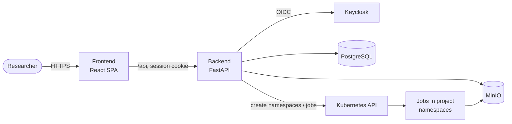

# Architecture

## Overview

## Components

| Component | Responsibility |
|---|---|
| Frontend | UI for projects, jobs and results. Talks only to the backend. |
| Backend | REST API. Handles login with Keycloak and keeps the session server-side. Creates Kubernetes resources for projects and jobs. |
| Keycloak | Identity provider (users, login, roles). |
| PostgreSQL | Users, projects, quotas, job records, audit log. |
| Kubernetes | Runs the platform itself and the jobs researchers submit. |
| MinIO | S3-compatible storage for datasets and job results. |

## Main flow: submitting a job

1. The researcher logs in. The backend redirects to Keycloak and, after login, sets a session cookie.
2. The researcher picks a project and a resource profile (e.g. CPU small, 1 GPU).
3. The backend checks the project quota, stores a job record and creates a Kubernetes Job in the project's namespace.
4. The job reads input from and writes results to the project's bucket in MinIO.
5. The backend tracks the job status and the frontend shows it.

## Decisions

Important decisions are recorded in [adr/](adr/).
